# Deska

> **🇺🇸 In English:** Deska is a gamified job-application tracker. You log job offers on a kanban board, drag them through six stages, keep sticky-note reminders, attach your CV and cover letters, and earn XP, levels, streaks and achievements as you apply. Everything syncs live between your computer and phone over WebSockets.
>
> **Built with:** Next.js 14 · React 18 · TypeScript · Tailwind CSS · NestJS 10 · Socket.IO · Supabase (PostgreSQL + Auth with Row Level Security) · npm workspaces monorepo with a shared domain package · **596 automated tests** (Vitest, Jest, Supertest, Testing Library).
>
> The interface and the rest of this README are in Spanish.

Tablero gamificado para registrar ofertas de empleo, seguir su avance y mantener
la información sincronizada entre la computadora y el teléfono.

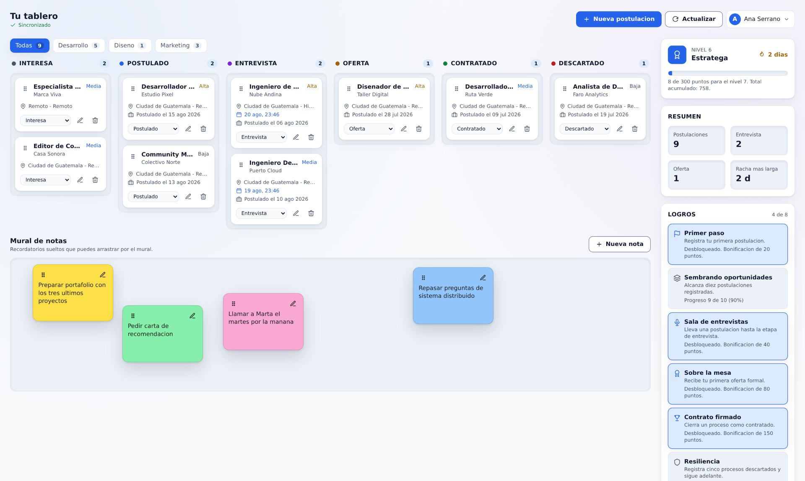

## Qué incluye

- **Tablero kanban** con seis estados y arrastre de tarjetas entre columnas.
- **Áreas del tablero** con nombre libre (desarrollo, marketing, lo que
  necesites) y un selector para ver una a la vez.
- **Mural de notas adhesivas** con arrastre libre, cinco colores y posición que
  se conserva entre dispositivos.
- **Captura manual** de empresa, puesto, ubicación, modalidad, prioridad,
  expectativa salarial, enlace, contacto, notas del proceso y fechas de
  postulación, entrevista y seguimiento.
- **Currículums y cartas subidos** a un bucket privado, elegibles desde la
  vacante; las notas admiten capturas.
- **Capa de juego**: experiencia, niveles con rango, racha diaria y ocho logros.
- **Doce temas visuales** nacidos de paletas propias y **dos paquetes de iconos**
  SVG intercambiables, cada uno con su capa de profundidad (superficies
  hundidas, sombras y fondo) y con el contraste verificado por pruebas.
- **Sincronización en vivo** por WebSockets entre todos los dispositivos de la
  misma cuenta.
- **Tutorial guiado** la primera vez, que atenúa la pantalla y destaca donde
  pulsar.

## Capturas

### Temas

El mismo tablero cambia por completo de personalidad sin tocar el markup: cada
tema redefine el mismo conjunto de variables CSS.

| Oscuro | Galaxy |
| --- | --- |
| 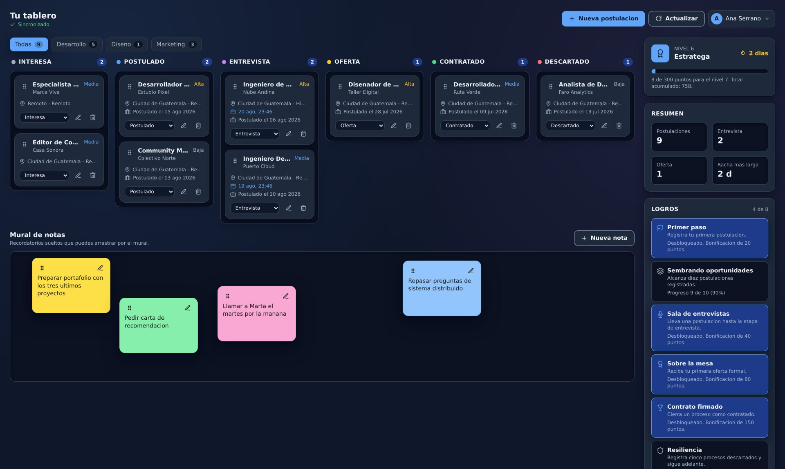 | 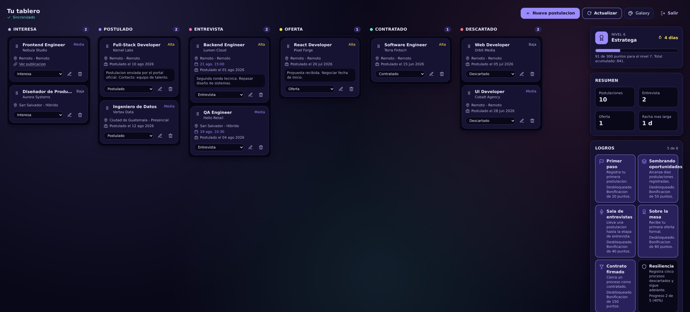 |

| Pixel rosa (con iconos pixel) | Gaming |
| --- | --- |
| 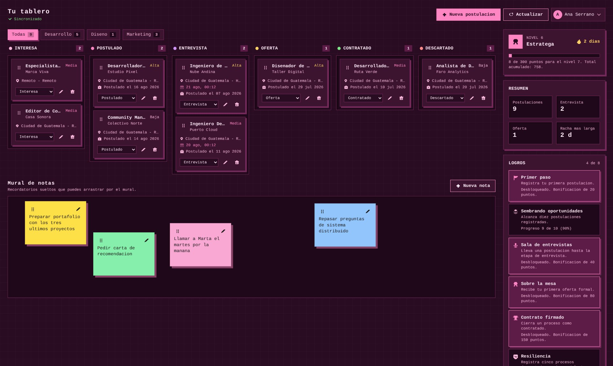 | 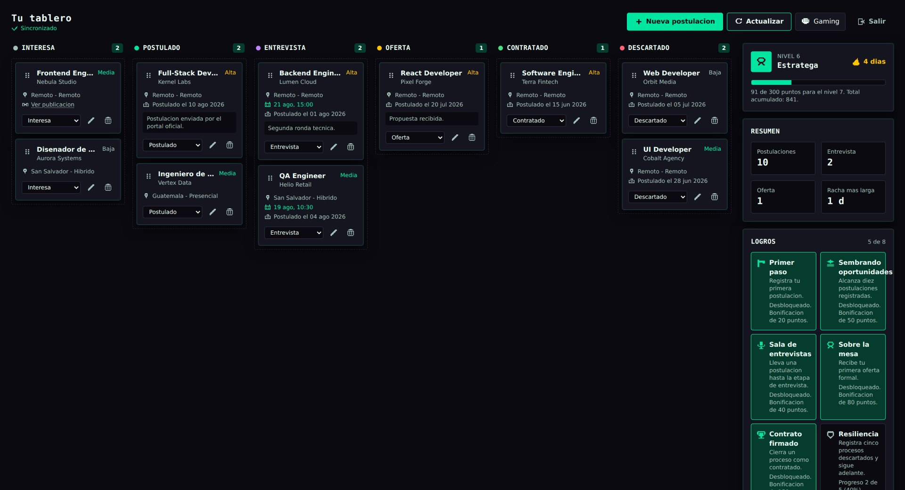 |

### Áreas y mural de notas

Sobre el tablero, una pestaña por área (con nombre libre) filtra lo que se ve sin
tocar el progreso. Debajo, el mural recoge los recordatorios sueltos: se
arrastran con el ratón, con el dedo o con el teclado, y su posición se guarda en
proporción al mural, así que se conserva al cambiar de dispositivo.

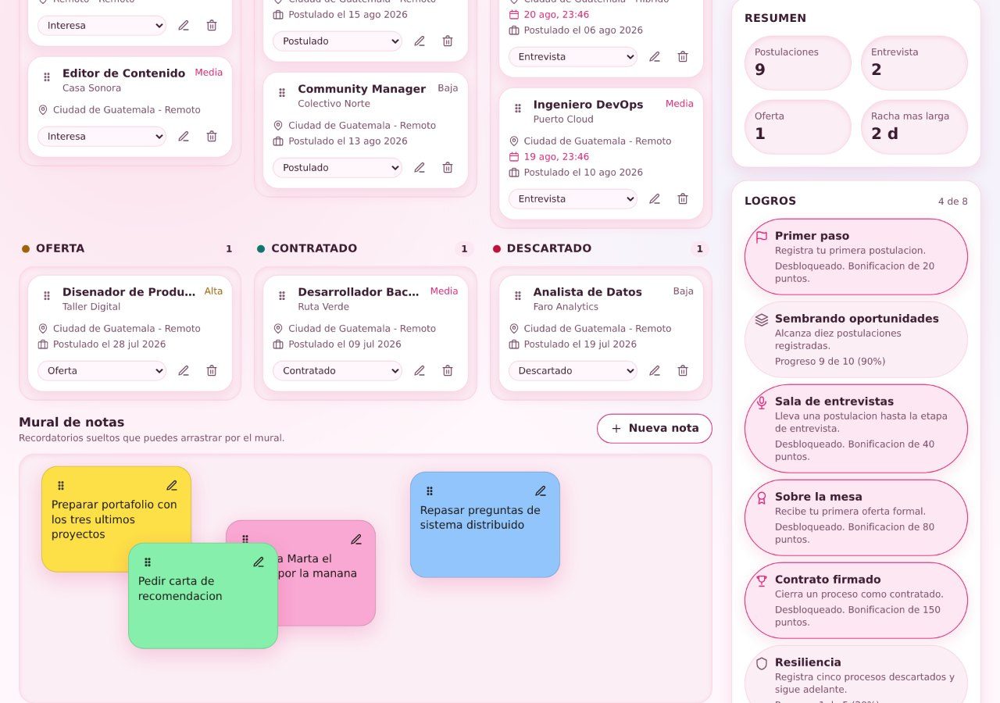

### Tutorial de bienvenida

Mientras el tablero esté vacío, un recorrido de cuatro pasos desenfoca el resto
de la interfaz y deja nitido solo el elemento que hay que usar. Se puede saltar
en cualquier momento y no vuelve a aparecer.

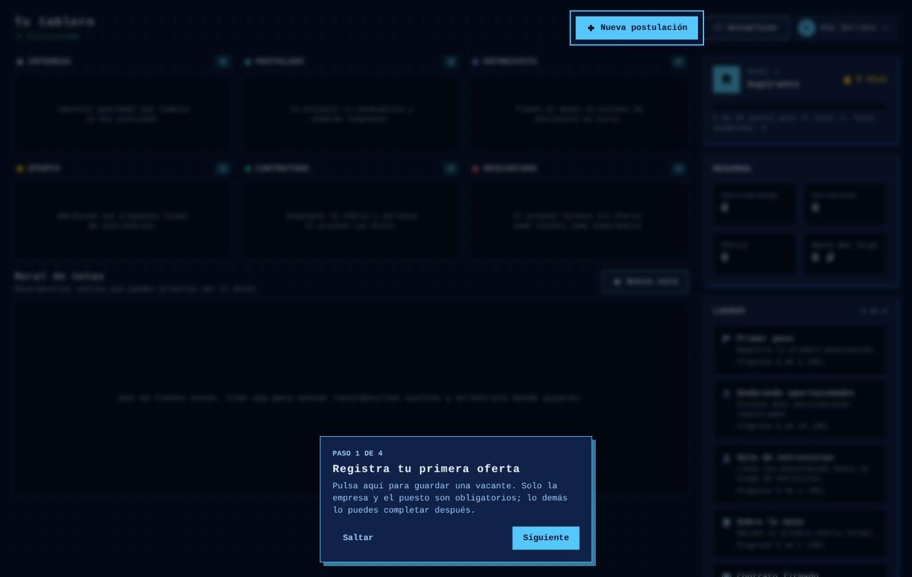

### Selector de apariencia

Doce temas agrupados en cuatro familias, dos paquetes de iconos con vista previa
dentro del panel de la cuenta.

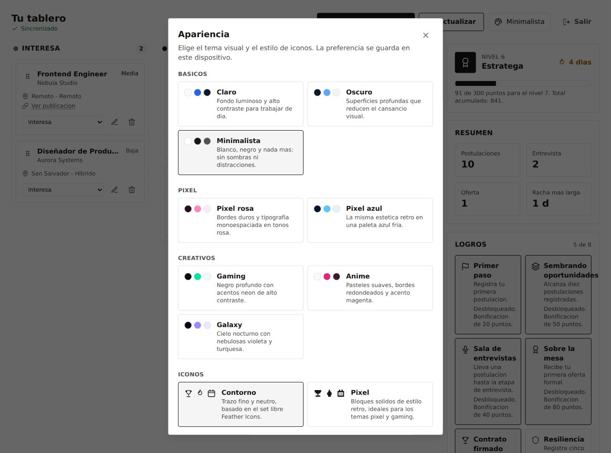

### Móvil

En pantallas pequeñas las columnas se apilan y el panel de progreso sube al
inicio. El selector de estado de cada tarjeta sustituye al arrastre.

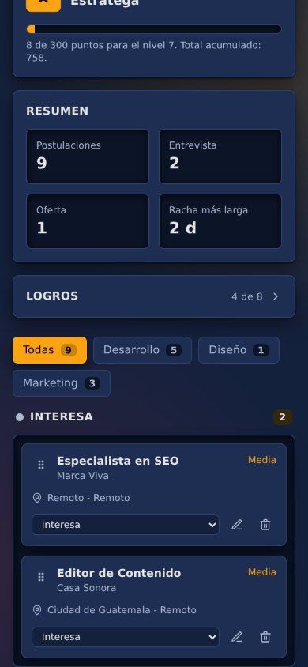

### Bienvenida y acceso

| Página de inicio | Inicio de sesión |
| --- | --- |
| 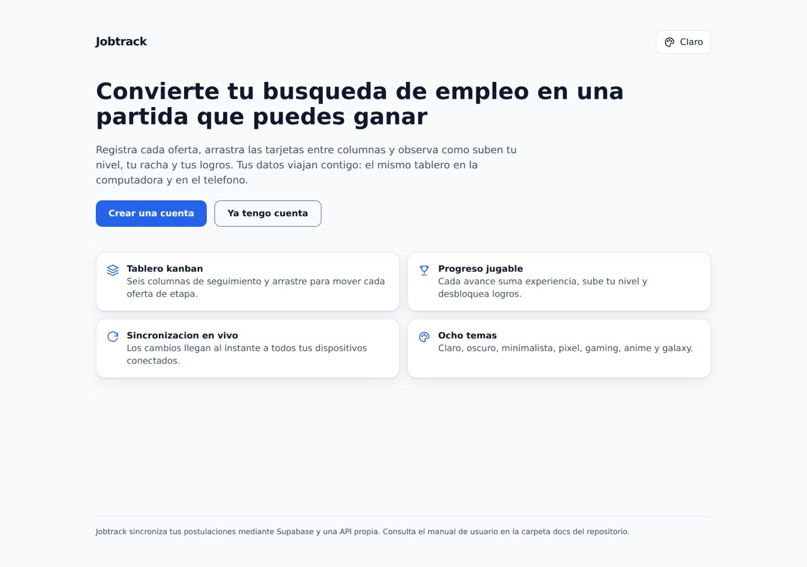 | 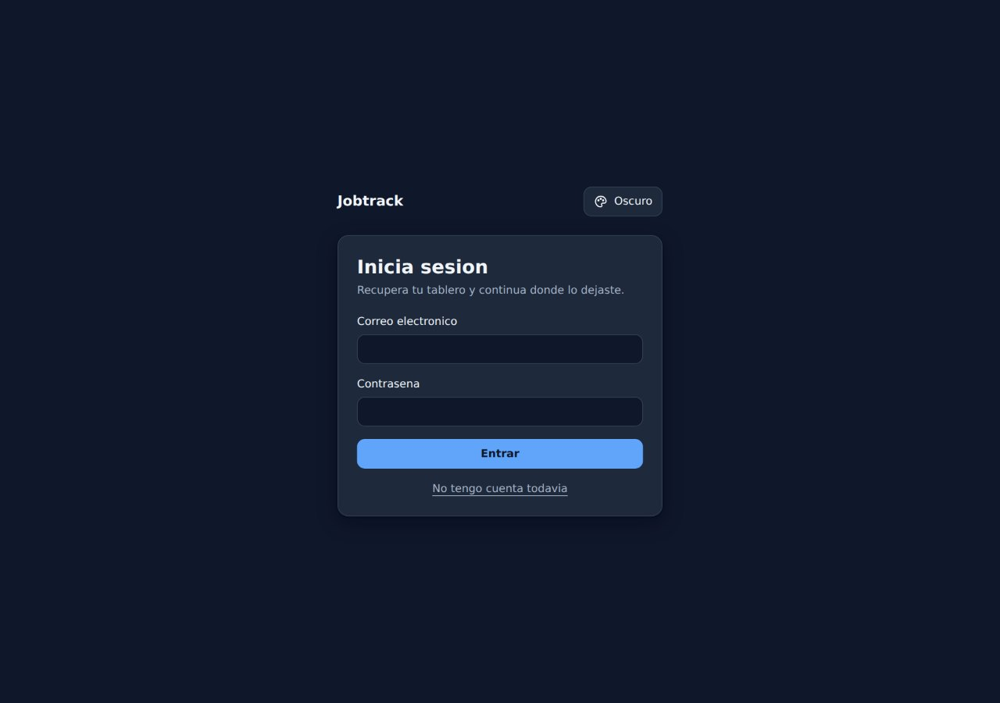 |

## Arquitectura

```
Deska/
  apps/
    api/                 API NestJS 10 (REST + WebSockets)
    web/                 Interfaz Next.js 14 (App Router) + Tailwind CSS 3
  packages/
    contracts/           Tipos y reglas de dominio compartidos
  supabase/
    schema.sql           Esquema PostgreSQL con RLS
  docs/
    MANUAL_USUARIO.md    Guía paso a paso
    MANUAL_TECNICO.md    Arquitectura, módulos y convenciones
    PLAN_DE_PRUEBAS.md   Casos, restricciones y resultados esperados
    capturas/            Imágenes de este README
```

Las reglas de dominio viven en `packages/contracts` y las consumen tanto la API
como la web. Gracias a eso el reordenamiento optimista del navegador y el que
persiste el servidor invocan la **misma** función, así que no pueden divergir.

El detalle de cada módulo está en [`docs/MANUAL_TECNICO.md`](docs/MANUAL_TECNICO.md).

## Stack

| Capa | Tecnología |
| --- | --- |
| Interfaz | Next.js 14 (App Router), React 18, TypeScript, Tailwind CSS 3 |
| Arrastre | dnd-kit (puntero y teclado) |
| API | NestJS 10, class-validator, Socket.IO, Helmet |
| Autenticación | Supabase Auth: Google y correo con contraseña; JWT verificado en la API |
| Base de datos | PostgreSQL 15 gestionado por Supabase, con Row Level Security |
| Pruebas | Vitest y Testing Library en la web, Jest y Supertest en la API |

## Puesta en marcha

Requisitos: Node.js 20 o superior.

```bash
npm install
cp apps/api/.env.example apps/api/.env
cp apps/web/.env.example apps/web/.env.local
```

Arranca los dos procesos en terminales separadas:

```bash
npm run dev:api    # http://localhost:4000/api
npm run dev:web    # http://localhost:3000
```

Con la configuración de ejemplo la API usa el driver `memory`, así que arranca
sin credenciales externas. Para persistir en PostgreSQL, ejecuta
`supabase/schema.sql` en tu proyecto de Supabase y completa en `apps/api/.env`:

```
DATA_DRIVER=supabase
SUPABASE_URL=https://<proyecto>.supabase.co
SUPABASE_SERVICE_ROLE_KEY=<clave de servicio>
ADMIN_EMAIL=<tu correo>          # opcional: habilita /admin solo para esa cuenta
```

El esquema se puede volver a ejecutar entero sobre un proyecto que ya existe:
tipos, tablas, indices y politicas se crean solo si faltan, y las columnas
añadidas después se aplican al final con `alter table ... add column if not exists`.

La API verifica los tokens con las claves publicas del proyecto (`SUPABASE_URL`),
así que no hace falta ningún secreto de firma. Solo los proyectos que aun usan el
esquema heredado HS256 necesitan además `SUPABASE_JWT_SECRET`.

Y en `apps/web/.env.local`:

```
NEXT_PUBLIC_API_URL=http://localhost:4000/api
NEXT_PUBLIC_SUPABASE_URL=https://<proyecto>.supabase.co
NEXT_PUBLIC_SUPABASE_ANON_KEY=<clave publica>
```

## Comandos

| Comando | Efecto |
| --- | --- |
| `npm run build` | Compila el paquete compartido, la API y la web |
| `npm test` | Ejecuta las suites de los tres paquetes |
| `npm run test:unit` | Solo pruebas unitarias |
| `npm run test:integration` | Solo pruebas de integracion |
| `npm run lint` | Análisis estático de la API y la web |

## Pruebas

596 casos, todos en verde y sin dependencias de red externas:

| Paquete | Herramienta | Casos |
| --- | --- | --- |
| `contracts` | Vitest | 159 |
| `api` | Jest y Supertest | 128 |
| `web` | Vitest y Testing Library | 309 |

Cubren las restricciones del plan: ausencia de conexión, valores nulos, datos
corruptos y sincronización entre dispositivos. Las pruebas de tiempo real
levantan la API en un puerto real y usan clientes `socket.io` auténticos. El
desglose completo está en [`docs/PLAN_DE_PRUEBAS.md`](docs/PLAN_DE_PRUEBAS.md).

## Despliegue

### Web en Vercel

Al importar el repositorio, en **Settings -> General**:

| Ajuste | Valor |
| --- | --- |
| Root Directory | `apps/web` |
| Include files outside the root directory | **Activado** |
| Framework Preset | Next.js (se detecta solo) |
| Build Command | por defecto (`npm run build`) |

Si defines un **Build Command propio**, referénciate al workspace **por ruta**
(`npm run build --workspace apps/web`) y no por nombre de paquete: la ruta
sobrevive a un cambio de nombre del producto, el nombre del paquete no.

El **Root Directory debe apuntar a `apps/web`**, no a la raíz: Vercel busca la
dependencia `next` en el `package.json` de ese directorio, y el de la raíz solo
declara los workspaces. La casilla de archivos externos es obligatoria porque la
web compila `packages/contracts` antes de construirse.

Variables de entorno del proyecto:

```
NEXT_PUBLIC_API_URL=https://<tu-api>/api
NEXT_PUBLIC_SUPABASE_URL=https://<proyecto>.supabase.co
NEXT_PUBLIC_SUPABASE_ANON_KEY=<clave publica>
```

Sin ellas la aplicación despliega igual y muestra un aviso explicando que falta
configurar Supabase, pero no permite iniciar sesión.

### Autenticación en producción

En **Authentication -> URL Configuration** del proyecto de Supabase:

| Campo | Valor |
| --- | --- |
| Site URL | El dominio publico de la web |
| Redirect URLs | `https://<dominio>/**` |

Para habilitar los accesos externos, en **Authentication -> Providers** pega el
identificador y el secreto de cada aplicación OAuth. En todas ellas el URI de
redireccion autorizado es `https://<proyecto>.supabase.co/auth/v1/callback`.

| Proveedor de Supabase | Donde se crea la aplicación |
| --- | --- |
| Google | Google Cloud, apartado de credenciales OAuth |

El servicio de correo integrado de Supabase esta pensado para desarrollo y
limita los envíos por hora. Un despliegue real que use registro por correo
necesita un **SMTP propio** configurado en *Project Settings -> Authentication*.

### API en Render

El repositorio incluye `render.yaml`, así que basta con **New -> Blueprint** y
seleccionar el repositorio. Render pedirá tres valores al crear el servicio:
`SUPABASE_URL`, `SUPABASE_SERVICE_ROLE_KEY` y `CORS_ORIGINS` (el dominio publico
de la web).

La API es un proceso persistente con WebSockets, así que no encaja en las
funciones serverless de Vercel: necesita un servicio con proceso continuo.

Para cualquier otro proveedor, los comandos son:

```bash
npm install --include=dev   # NODE_ENV=production omitiria TypeScript y la CLI de Nest
npm run build --workspace apps/api
npm run start:prod --workspace apps/api
```

La sonda de disponibilidad es `GET /api/health`.

## Convenciones de código

- TypeScript estricto en los tres paquetes.
- Sin emojis en el código ni en la interfaz; la iconografia es SVG vectorial
  (ver [`apps/web/src/components/icons/ICONS_LICENSE.md`](apps/web/src/components/icons/ICONS_LICENSE.md)).
- Una sola fuente por regla: si una logica se necesita en la API y en la web,
  vive en `@deska/contracts`.

## Licencia

MIT.
